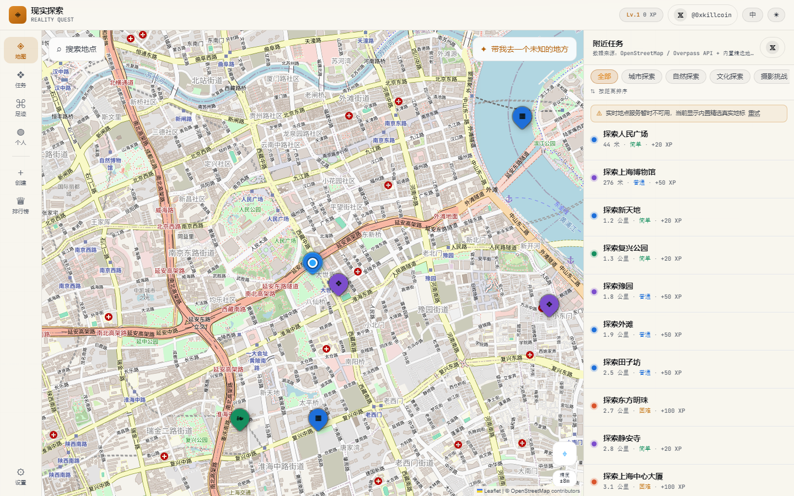
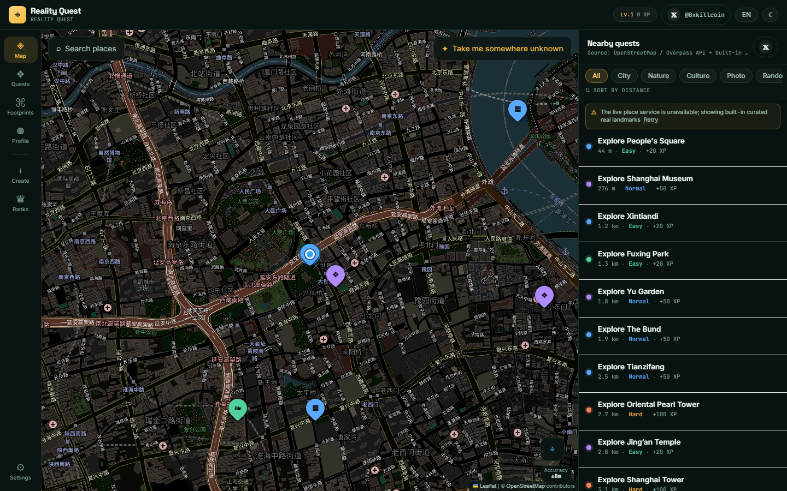
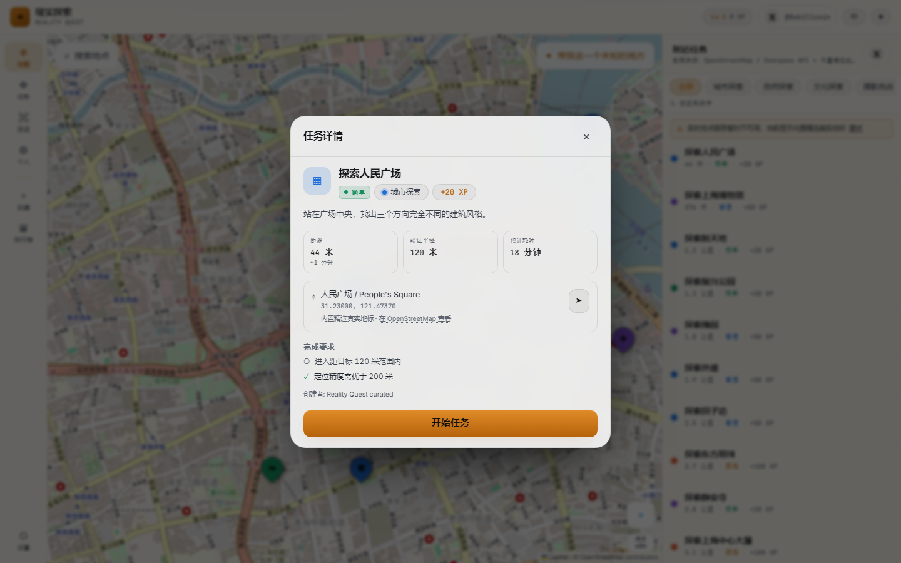
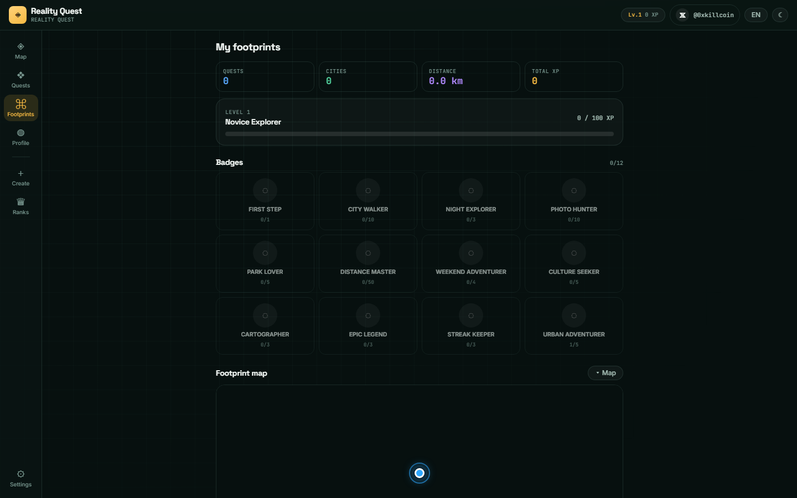
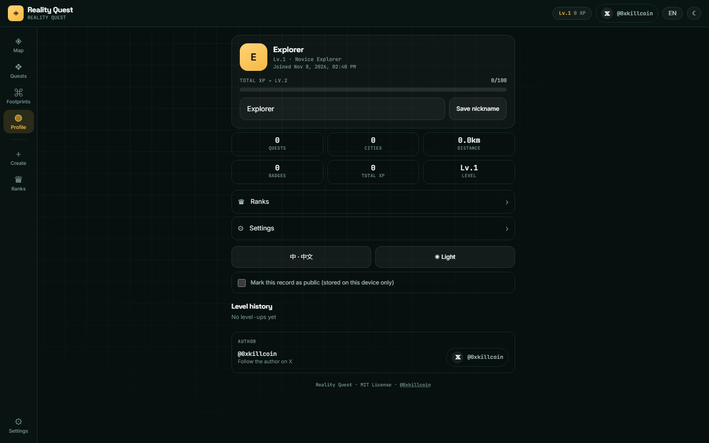
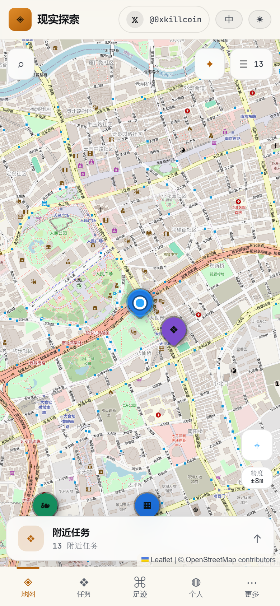
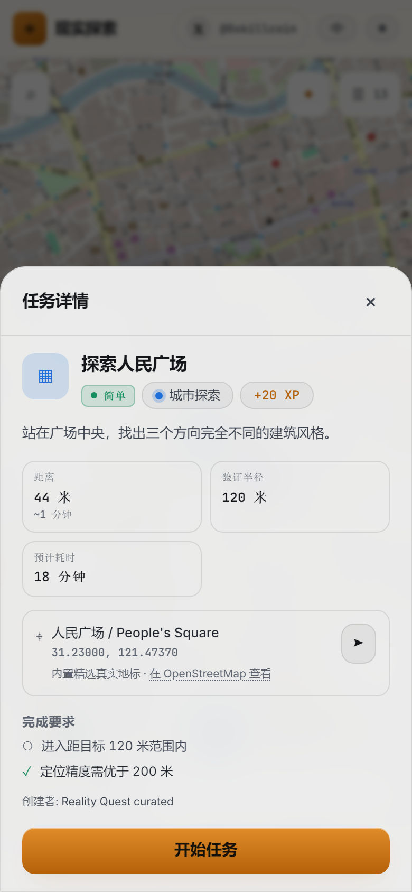

# Reality Quest · 现实探索

> **把现实世界，变成一场开放世界游戏。**
> Turn the real world into an open-world game.

[](https://github.com/iiiiiiiiiiiiiKK/reality-quest/actions/workflows/ci.yml)
[](https://github.com/iiiiiiiiiiiiiKK/reality-quest/actions/workflows/pages.yml)
[](./LICENSE)

**作者 / Author:** [𝕏 @0xkillcoin](https://x.com/0xkillcoin)

**在线体验 / Live demo:** https://iiiiiiiiiiiiiKK.github.io/reality-quest/

---

## 目录 · Table of contents

- [它是什么](#它是什么--what-it-is)
- [核心体验](#核心体验--core-loop)
- [截图](#截图--screenshots)
- [功能清单](#功能清单--features)
- [GPS 验证的真实边界](#gps-验证的真实边界--what-the-verification-actually-proves)
- [技术栈](#技术栈--tech-stack)
- [本地运行](#本地运行--run-locally)
- [测试](#测试--testing)
- [部署](#部署--deployment)
- [数据与隐私](#数据与隐私--data--privacy)
- [地图与外部服务](#地图与外部服务--maps--external-services)
- [已知限制](#已知限制--known-limitations)
- [后续方向](#后续方向--roadmap)
- [License](#license)

---

## 它是什么 · What it is

**Reality Quest（现实探索）** 是一个把真实城市当作开放世界地图的探索游戏。

你不需要买设备，也不需要进入虚拟世界。打开手机，走出家门，发现附近一个真实存在的地点，走到那里，用 GPS 验证你确实到了，留下照片和记录，获得 XP、等级和徽章。

Reality Quest is a real-world exploration game. Your city *is* the map. Find a real place nearby, walk to it, verify your arrival with GPS, keep a photo and a note, and earn XP, levels and badges.

不是旅游攻略，不是签到工具，不是后台管理系统。核心循环只有一条：

```
发现 → 前往 → 验证到达 → 留下证明 → 获得奖励 → 解锁下一层
```

---

## 核心体验 · Core loop

| 步骤 | 发生什么 | 真实实现 |
|---|---|---|
| **发现** | 地图上出现附近的真实地点任务 | Leaflet + OpenStreetMap 瓦片；Overpass API 拉取真实公园/广场/博物馆/历史建筑/公共艺术；外加内置的精选真实地标（离线可用） |
| **前往** | 打开外部导航，或直接看地图上的距离 | 每一帧用 Haversine 公式实时计算你与目标的真实距离 |
| **验证到达** | 点击「验证到达」 | 浏览器 Geolocation API 取一次新定位，检查 `distance + accuracy ≤ radius` |
| **留下证明** | 拍照 / 写记录 / 选择是否公开 | 照片在浏览器端压缩后存入 IndexedDB，不上传服务器 |
| **获得奖励** | XP → 等级 → 徽章 | 幂等写入：同一任务永远只发一次奖励 |
| **解锁** | 足迹地图、徽章墙、时间线 | 全部从真实完成记录反推，不存可变的计数器 |

---

## 截图 · Screenshots

以下截图全部来自真实运行的构建产物（Playwright 自动截取，见 `e2e/shots.mjs`）。

### 桌面端 · Desktop

| 深色 · Dark | 浅色 · Light |
|---|---|
|  |  |

### 任务详情 · Quest detail



### 足迹 · Footprints



### 个人档案 · Profile



### 移动端 · Mobile (iPhone 390×844)

| 地图 · Map | 任务列表 · Sheet |
|---|---|
|  |  |

| 任务详情 · Quest |
|---|
|  |

---

## 功能清单 · Features

### 探索地图
- 真实 OpenStreetMap 瓦片，正确署名
- 当前定位标记 + 精度圈（真实 `accuracy` 值）
- 任务标记按类型配色、按状态变化（可挑战 / 进行中 / 已完成 / 未解锁）
- 拖动、缩放、回到当前位置
- 地点搜索（Nominatim，带限速与超时）
- 地图 / 任务列表切换（移动端为可收起的底部抽屉）
- 按类型筛选、按距离或 XP 排序

### 任务
- 五种类型：城市 / 自然 / 文化 / 摄影 / 随机
- 四种难度：简单 20 XP / 普通 50 XP / 困难 100 XP / 史诗 200 XP
- 难度越高，验证半径越小（120 / 100 / 50 / 40 米）
- 每个任务包含名称、描述、坐标、半径、难度、XP、预计耗时、完成条件、创建者、来源
- 明确区分数据来源：`OpenStreetMap 真实地点` / `内置精选真实地标` / `本机社区任务`

### GPS 到达验证
- Haversine 距离计算
- 读取并校验 `latitude` / `longitude` / `accuracy` / `timestamp`
- **精度不足时拒绝判定成功**，并提示移动到开阔处
- 权限被拒绝 / 设备不支持：给出明确说明，页面仍然可用
- 每次验证都强制取新定位，不复用缓存读数

### 探索证明
- 拍照或从相册选择
- Canvas 端压缩（最长边 1600px，JPEG，带二次降质兜底）
- 文字记录（最多 2000 字）
- 记录真实到达坐标、精度、与目标距离
- 可随时删除照片和记录

### 成长系统
- 七级成长曲线：新手探索者 → 街区漫游者 → 城市发现者 → 地图猎人 → 城市探险家 → 世界漫游者 → 传奇探索者
- XP 进度条、升级动画、升级历史
- 12 个徽章，全部由已完成记录纯函数推导，**点击徽章无法解锁**
- 徽章有进度提示（如 `7/10`），未解锁显示灰色剪影

### 足迹
- 完成数、探索城市数、累计足迹、总 XP、当前等级
- 足迹地图：标记**真实到达点**（不是任务创建坐标）并连成探索路径
- 时间线：最近 7 天 / 30 天 / 全部
- 单条记录的详情、公开状态切换、删除（删除同时扣除该条 XP）

### 社区任务
- 创建本地任务：标题、描述、类型、坐标（GPS 或地图点选）、半径、难度、是否需照片、是否公开
- 明确标注「只保存在本机，其他人看不到」
- 服务端限制说明写在 UI 和 README 中，不假装有后端

### 其他
- 中 / English 双语切换（含所有 UI 文案与任务标题）
- 深色 / 浅色主题切换（浅色为纸质地图风）
- 移动端优先的自适应布局，44px 最小触控目标，安全区适配
- 定位权限说明、新用户引导
- 空状态、加载状态、错误状态、超时状态、离线降级状态
- 导出 / 导入 JSON（含照片），导入前严格校验结构
- 清空本地数据
- 顶部固定显示作者 𝕏 链接：[x.com/0xkillcoin](https://x.com/0xkillcoin)

---

## GPS 验证的真实边界 · What the verification actually proves

这一节很重要，请不要跳过。

**本版本是纯前端（Local-first）应用，没有服务端。** 因此：

✅ **它能做到**
- 阻止「坐在家里点按钮就完成任务」
- 阻止定位精度不足以支撑判定的读数通关
- 阻止同一任务重复领取奖励（任务完成记录是唯一事实来源，写入时在一个 IndexedDB 事务里做存在性检查）
- 阻止「前端随便改状态」——状态不是被改的，而是从完成记录推导出来的

⚠️ **它不能做到**
- 不能抵御开发者工具篡改。任何纯前端 GPS 验证都可以被绕过（改 JS、改 IndexedDB、用模拟定位）。**本项目不宣称自己拥有无法作弊的 GPS 验证。**
- 不能防止照片是别处拍的（没有接入图像识别，也不会假装有）

如果需要真正抗作弊的验证，必须加服务端：目标坐标、半径、时间戳、设备指纹、异常速度/跳跃检测全部放在服务端判定，客户端只提交原始读数。架构上本项目的 `store.completeQuest()` 就是未来接服务端时唯一需要被替换的入口。

---

## 技术栈 · Tech stack

| 层 | 选择 | 理由 |
|---|---|---|
| 框架 | React 18 + TypeScript 5 | 类型安全，生态成熟 |
| 构建 | Vite 5 | 快，产出静态资源，天然适配 GitHub Pages |
| 样式 | Tailwind CSS 3 + CSS 变量 | 双主题靠 CSS 变量切换，不重复写两套样式 |
| 地图 | Leaflet 1.9 + react-leaflet 4 | 轻量、无 API Key、OSM 生态标准 |
| 状态 | Zustand 4 | 极小，无 Provider 地狱 |
| 存储 | IndexedDB（`idb`） | 图片必须能存 Blob，localStorage 放不下 |
| 测试 | Vitest + Testing Library；Playwright 端到端 | 纯函数单测 + 真浏览器验证 |
| 部署 | GitHub Pages（Actions） | 纯静态，免费，HTTPS |

没有后端、没有数据库服务、没有账号系统——这是刻意的设计选择，见下节。

---

## 本地运行 · Run locally

需要 Node.js 18+（推荐 20+）。

```bash
git clone https://github.com/iiiiiiiiiiiiiKK/reality-quest.git
cd reality-quest
npm install
npm run dev
```

打开终端输出的地址（默认 http://localhost:5173）。

> **定位必须在安全上下文（HTTPS 或 localhost）下才会被浏览器允许。** 用局域网 IP 访问 `http://192.168.x.x:5173` 会拿不到定位——这是浏览器规则，不是项目 Bug。要在手机上本地调试，请用 `ngrok`/`cloudflared` 之类的隧道给出 HTTPS 地址。

### 可用脚本

```bash
npm run dev        # 开发服务器
npm run typecheck  # TypeScript 类型检查
npm run lint       # ESLint（0 warning 策略）
npm test           # 单元测试（Vitest）
npm run build      # 类型检查 + 生产构建
npm run preview    # 预览生产构建
```

### 环境变量

**本项目不需要任何环境变量，也不需要任何 API Key。** 所有外部服务都是无需鉴权的公开端点（见下文「地图与外部服务」）。因此仓库里没有 `.env`，只有 `.env.example` 作为说明占位：

```bash
# No environment variables are required.
# All external services used are keyless public endpoints.
# See README "Maps & external services" for rate limits and policies.
```

---

## 测试 · Testing

### 单元测试（Vitest）

```bash
npm test
```

当前结果：**7 个测试文件，89 个测试，全部通过。**

覆盖范围（均为纯函数或 IndexedDB 层，可复现）：

| 文件 | 覆盖内容 |
|---|---|
| `src/test/geo.test.ts` | Haversine 距离（含上海–北京 1067km 参考值）、精度感知的验证判定、距离格式化、轨迹增量、坐标合法性 |
| `src/test/levels.test.ts` | 等级曲线单调性、阈值边界、XP 表与难度半径一致性 |
| `src/test/db.test.ts` | **幂等性**（同一任务只发一次 XP）、删除记录回退 XP、导出/导入往返、非法 bundle 拒绝且不破坏现有数据 |
| `src/test/achievements.test.ts` | 徽章解锁条件、跨类别统计、连续天数、徽章目录唯一性 |
| `src/test/services.test.ts` | Overpass 响应归一化（丢弃无名/无坐标要素）、POI→Quest 确定性、缓存分桶 |
| `src/test/curated.test.ts` | 内置地标坐标合法性、id 唯一、双语完整性、最近地标排序 |
| `src/test/i18n.test.ts` | 中英 key 集合完全一致、无空值、插值、X 链接常量 |

### 端到端测试（Playwright，真实 Chrome）

```bash
# 终端 1
npm run build
node e2e/serve.mjs dist          # http://127.0.0.1:4173

# 终端 2
CHROME_PATH="/path/to/chrome" BASE_URL="http://127.0.0.1:4173" node e2e/run.mjs
```

当前结果：**21 项全部通过。**

| # | 验证项 | 结果 |
|---|---|---|
| 1 | 应用加载、标题正确 | ✅ |
| 1b | 顶部作者 𝕏 链接指向 `https://x.com/0xkillcoin` | ✅ |
| 2 | 首次打开显示新用户引导 | ✅ |
| 2b | 引导结束后应用外壳可用 | ✅ |
| 3 | 附近任务列表有真实条目 | ✅（13 条） |
| 4 | 点击任务打开详情面板 | ✅ |
| 5 | **距离目标 5.5km 时验证被拒绝** | ✅ |
| 6 | 到达半径内 → 照片上传 → 完成任务 | ✅ |
| 7 | 头部显示获得的 XP | ✅（+20 XP） |
| 8 | 刷新后数据保留且**不重复发奖** | ✅（20 → 20） |
| 9 | 中英切换生效 | ✅ |
| 10 | 深浅主题切换生效 | ✅ |
| 11 | 无意外 console 错误 | ✅ |
| 12 | **定位被拒绝时应用仍可正常浏览** | ✅ |
| 13 | 移动端无横向溢出 | ✅（390/390） |
| 14 | 底部导航触控目标 ≥ 44px | ✅（全部 54×78） |
| 15 | 移动端作者 𝕏 链接可见 | ✅ |
| 16 | 移动端地图占据主要视觉区 | ✅（390×734） |
| 17 | 移动端任务抽屉可打开 | ✅ |
| 18 | 关闭抽屉后地图仍可交互 | ✅ |
| 19 | 平板视口无横向溢出 | ✅（834/834） |

截图由同一套 Playwright 脚本产出：`node e2e/shots.mjs`。

---

## 部署 · Deployment

### GitHub Pages（当前使用）

`.github/workflows/pages.yml` 会在每次推送到 `main` 时：安装依赖 → 构建 → 把 `index.html` 复制为 `404.html`（SPA 回退）→ 发布到 Pages。

一次性的仓库设置：**Settings → Pages → Source = GitHub Actions**。

`vite.config.ts` 使用 `base: './'`，所以同一份构建产物既能放在 `/<repo>/` 子路径，也能放在根域，不需要改配置。

### Cloudflare Pages（备选）

| 设置 | 值 |
|---|---|
| Build command | `npm run build` |
| Build output directory | `dist` |
| Node version | 20 |
| 环境变量 | 无 |

### Vercel（备选）

Framework preset 选 Vite，Build `npm run build`，Output `dist`，不需要环境变量。

> 任何静态托管都可以，因为这是纯静态产物。GPS 需要 HTTPS——上面三个平台默认都是 HTTPS。

---

## 数据与隐私 · Data & privacy

- **所有数据都在你自己的浏览器里。** 没有账号，没有服务器，没有遥测。
- 任务、完成记录、徽章、社区任务、照片 → IndexedDB（`reality-quest` 数据库）
- 语言、主题、引导状态 → localStorage（少量键）
- **位置信息只在两种情况下读取**：显示附近任务时定位一次、验证到达时定位一次。不做后台轨迹追踪，不存储移动历史。
- 记录里保存的是「你到达时的坐标」，这是游戏机制需要的。你可以在足迹页删除任意单条记录及其照片。
- 照片只在本地压缩和存储，不会上传。但它可能包含地点信息，请自行判断是否公开。
- 可以随时导出完整 JSON（含照片）或清空全部本地数据。

⚠️ 向外部服务发出的请求会暴露你所看的区域：地图瓦片请求暴露瓦片坐标范围，Overpass 请求暴露搜索圆心与半径，Nominatim 请求暴露搜索词或反查坐标。这是使用这些免费公共服务的固有代价，已在此明确说明。

---

## 地图与外部服务 · Maps & external services

| 服务 | 用途 | 使用政策要点 | 本项目如何遵守 |
|---|---|---|---|
| **OpenStreetMap 瓦片** `tile.openstreetmap.org` | 底图 | 有明确的使用政策，禁止当作无限量商业 API；必须署名 | 保留官方 attribution；失败时降级提示而不是崩溃 |
| **Overpass API** | 拉取附近真实 POI | 非无限资源，需要超时与错误处理 | 单次请求 14s 超时、双端点轮换、6 小时本地缓存、触发限流后 60s 冷却、禁止循环重试 |
| **Nominatim** | 地点搜索、完成时反查城市名 | **有严格速率限制**，禁止高频批量请求 | 全局 1.1s 最小间隔、10s 超时、30 天缓存、每次完成只反查一次 |
| **内置地标** `src/lib/curated.ts` | Overpass 不可用时的离线地板 | — | 96 个真实地标（覆盖 22 座城市），手写真实 WGS84 坐标，UI 明确标注为「内置精选真实地标」 |

**明确声明：** OSM 是地图数据项目，不代表所有瓦片服务可无限免费使用。本项目没有把任何公共服务包装成无限量 API，也不对商业使用许可作任何承诺。如果要在这个基础上做商业产品，请自行申请商业瓦片服务（如 MapTiler / Thunderforest / Stadia）并替换 `TILE_URL`。

**降级链：**
```
Overpass 有结果  →  真实 OSM 任务 + 内置地标
Overpass 超时/限流 →  内置地标 + 明确的服务不可用提示（带重试）
完全离线         →  内置地标 + 地图瓦片失败提示（地图仍可操作）
```

---

## 已知限制 · Known limitations

| # | 限制 | 影响 | 说明 |
|---|---|---|---|
| 1 | 纯前端 GPS 验证可被篡改 | 作弊者能伪造完成 | 已在上文单独说明；抗作弊必须上服务端 |
| 2 | 没有后端 | 社区任务只在本机；没有真实全球排行榜 | 排行榜页面明确写的是「你的个人记录」 |
| 3 | 没有图像识别 | 无法判断照片是否符合任务要求 | 不会假装有；照片只作为人证 |
| 4 | 累计足迹是下界 | 显示的距离小于实际步行距离 | 只能测到「上一个验证点 → 这个验证点」的直线距离，UI 与本文档都按此说明 |
| 5 | Overpass 覆盖不均 | 某些区域真实 POI 稀疏 | 由内置地标兜底，且不伪造坐标 |
| 6 | Nominatim 限速 | 搜索需要等待约 1 秒 | 刻意为之，避免滥用公共资源 |
| 7 | 无 PWA 离线缓存 | 断网无法打开页面 | 数据本身不丢，但需要联网加载应用 |
| 8 | 未做多语言以外的本地化 | 只有中/英 | — |

---

## 后续方向 · Roadmap

三个最值得做的功能，按性价比排序：

1. **Supabase 后端 + 真实账号**
   完成记录上云 → 真正的抗作弊验证（服务端判定距离/精度/时间/异常速度）、真实城市排行榜、跨设备同步。现有 `completeQuest()` 已经是唯一需要替换的接缝。

2. **路线化的多站点任务链（Quests Chain）**
   把 3–5 个真实地点串成一条可步行的探索路线，完成整条链解锁稀有徽章。仍然只用真实坐标，但游戏性会强一个数量级。

3. **照片时间线与回忆回放**
   把同一天的记录自动拼成一条「这一天你走过的地方」，带照片、时间、距离。这是本地数据能提供的最高情感回报，且完全不需要后端。

其他候选：PWA + 离线缓存、导入 OSM 关系构成的大范围「区域任务」、协作式社区任务（需后端 + 审核）。

---

## 贡献 · Contributing

欢迎提 Issue 和 PR。请确保：

- `npm run typecheck && npm run lint && npm test && npm run build` 全部通过
- 不要引入任何需要 API Key 的依赖
- 不要伪造数据源（任何新任务必须能追溯到真实地点）
- 涉及 GPS 判定逻辑的改动必须补单元测试

---

## License

[MIT](./LICENSE) © 2025 [@0xkillcoin](https://x.com/0xkillcoin)

地图数据 © [OpenStreetMap contributors](https://www.openstreetmap.org/copyright)，按 [ODbL](https://opendatacommons.org/licenses/odbl/) 授权。

